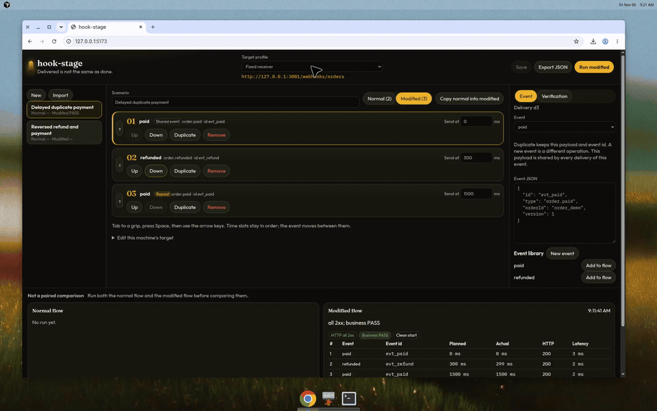

# hook-stage

[Türkçe](README.tr.md)


[](https://github.com/bymustfa/hook-stage/actions/workflows/ci.yml)
[](https://github.com/bymustfa/hook-stage/actions/workflows/codeql.yml)
[](https://github.com/bymustfa/hook-stage/actions/workflows/scorecard.yml)
[](LICENSE)

hook-stage is a local WebUI for replaying webhook scenarios against a localhost app. It shows the HTTP result and the business result as two separate outcomes, so a run can be **all 2xx** and still **fail** the business check.

The package is not published. The npm badges are placeholders and do not link to a registry.



A longer recording is in [`docs/media/hook-stage-demo.mp4`](docs/media/hook-stage-demo.mp4).

## Quickstart

Requires Node.js 22+.

```bash
pnpm install
pnpm dev
```

In two other terminals, start the synthetic receivers:

```bash
pnpm receiver:buggy   # http://127.0.0.1:3000
pnpm receiver:fixed   # http://127.0.0.1:3001
```

Open <http://127.0.0.1:5173>. The delayed-duplicate payment scenario is already loaded.

Or start the API, the UI, and both receivers together:

```bash
pnpm demo
```

Production mode serves the built UI from Fastify:

```bash
pnpm build
pnpm start
```

Then open <http://127.0.0.1:8787>.

## What you can do

- Edit webhook events as JSON and catch syntax errors before a run.
- Arrange deliveries on a sortable card list (drag, keyboard, up/down, duplicate, remove, delay). Duplicating a card keeps the event id and creates a new delivery id.
- Keep a **normal** flow and a **modified** flow (duplicate, reversed order, or delay) as tabs.
- Run either flow. The Node process sends the webhooks. The browser does not.
- After every delivery has responded or timed out, poll one state endpoint until a completion condition holds, then evaluate every assertion against that single response.
- See HTTP and business results side by side. Example: `all 2xx; business FAILED: paymentApplications expected 1, got 2`.
- Confirm an explicit fixture reset hook. hook-stage never wipes application data unless you confirm that hook. Runs without a clean start are not presented as a paired comparison.
- Import and export `formatVersion: 1` JSON. Import only opens the scenario. It does not call the network, reset fixtures, or start a run.
- Cancel a run. Restarting the server marks an in-flight run interrupted and does not send the rest.

## Try the payment demo

`examples/order-receiver` is a synthetic order book. No money moves.

The modified flow in `fixtures/delayed-duplicate-payment.json` is `order.paid`, then `order.refunded`, then a late duplicate of the same `order.paid` event id.

| Receiver | What it does | Modified flow |
| --- | --- | --- |
| Buggy (`pnpm receiver:buggy`) | Applies every delivery, including duplicates and stale versions | HTTP all 2xx, business FAIL (`paymentApplications` is 2, status goes back to `paid`) |
| Fixed (`pnpm receiver:fixed`) | Ignores a repeated event id and ignores an older domain version | HTTP all 2xx, business PASS (`refunded`, `paymentApplications` 1) |

`fixtures/reversed-order.json` delivers the refund before the payment. The fixed receiver keeps the newer domain version. That is a property of this sample app, not an exactly-once guarantee for a real provider.

Switch the target profile in the header (`Buggy receiver` on port 3000, `Fixed receiver` on port 3001). Confirm **Reset fixture and run** so both runs start from an empty order book.

## Scenario file

```json
{
  "formatVersion": 1,
  "name": "Delayed duplicate payment",
  "targetProfile": "local-demo",
  "events": [{ "key": "paid", "body": { "id": "evt_paid", "type": "order.paid", "orderId": "order_demo", "version": 1 } }],
  "variants": [
    { "id": "normal", "deliveries": [{ "id": "d1", "eventKey": "paid", "atMs": 0 }] },
    { "id": "modified", "deliveries": [{ "id": "d2", "eventKey": "paid", "atMs": 1500 }] }
  ],
  "verification": {
    "statePath": "/__test/orders/order_demo",
    "readyWhen": { "pointer": "/pendingJobs", "equals": 0 },
    "timeoutMs": 5000,
    "pollIntervalMs": 200,
    "assertions": [
      { "pointer": "/status", "operator": "equals", "expected": "refunded" },
      { "pointer": "/paymentApplications", "operator": "equals", "expected": 1 }
    ]
  },
  "reset": { "method": "POST", "path": "/__test/reset" }
}
```

- `formatVersion` must be `1`.
- `atMs` is the target send time from the start of the run, not the time the event was created.
- `targetProfile` names a profile stored on this machine (`baseUrl` + `webhookPath`). The URL is not part of the export.
- Assertions use JSON Pointer with `equals` or `exists`. There is no expression language.
- Business status is `PASS`, `FAIL`, `UNVERIFIED`, `CHECK_ERROR`, or `TIMEOUT`. Missing verification is `UNVERIFIED`, not a pass.
- Same-time deliveries start in list order. Exact receive order on the target is not guaranteed.

## Security boundaries

- The server listens on `127.0.0.1` only.
- Target base URLs must be loopback (`localhost`, `127.0.0.1`, or `::1`). Redirects are not followed.
- Mutating requests need the per-process session token. Browser origins other than the local UI are rejected.
- Payloads, timeouts, and concurrency are capped. There is no hidden retry.
- Header secrets are not part of the scenario file. Payloads you type are stored locally as you wrote them.

## Development

```bash
pnpm lint
pnpm typecheck
pnpm test
pnpm build
```

Layout: `apps/web`, `apps/server`, `packages/scenario`, `examples/order-receiver`, `fixtures`, `tests`, `docs`.

Out of scope for this version: provider signature forging, tunnels, accounts, fuzzing, arbitrary JavaScript assertions, shell or database access, and a separate headless CI CLI. npm, GitHub release assets, and Docker publish steps exist in CI and are disabled.

## License

[MIT](LICENSE)
