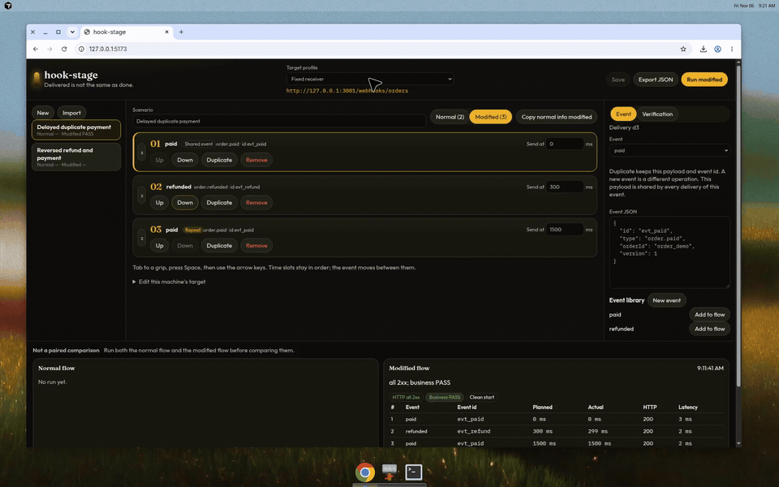

# hook-stage

[English](README.md)


[](https://github.com/bymustfa/hook-stage/actions/workflows/ci.yml)
[](https://github.com/bymustfa/hook-stage/actions/workflows/codeql.yml)
[](https://github.com/bymustfa/hook-stage/actions/workflows/scorecard.yml)
[](LICENSE)

hook-stage, webhook senaryolarını localhost üzerindeki bir uygulamaya yeniden oynatan yerel bir WebUI’dir. HTTP sonucu ile iş sonucunu ayrı gösterir. Bir koşu **tümü 2xx** olabilir ve iş kontrolü yine de **başarısız** sayılır.

Paket yayınlanmadı. npm rozetleri yer tutucudur ve bir kayıt defterine bağlanmaz.



Daha uzun kayıt: [`docs/media/hook-stage-demo.mp4`](docs/media/hook-stage-demo.mp4).

## Hızlı başlangıç

Node.js 22 veya daha yenisi gerekir.

```bash
pnpm install
pnpm dev
```

İki ayrı terminalde sentetik alıcıları başlatın:

```bash
pnpm receiver:buggy   # http://127.0.0.1:3000
pnpm receiver:fixed   # http://127.0.0.1:3001
```

<http://127.0.0.1:5173> adresini açın. Geciken yinelenen ödeme senaryosu yüklü gelir.

API, arayüz ve iki alıcıyı birlikte başlatmak için:

```bash
pnpm demo
```

Üretim modu derlenmiş arayüzü Fastify üzerinden sunar:

```bash
pnpm build
pnpm start
```

Ardından <http://127.0.0.1:8787> adresini açın.

## Ne yapabilirsiniz

- Webhook olaylarını JSON olarak düzenleyip sözdizimi hatalarını koşudan önce görebilirsiniz.
- Teslimatları sıralanabilir kart listesinde düzenlersiniz (sürükleme, klavye, yukarı/aşağı, çoğaltma, kaldırma, gecikme). Çoğaltma olay kimliğini korur ve yeni bir teslimat kimliği üretir.
- **Normal** akış ve **değiştirilmiş** akış (tekrar, ters sıra veya gecikme) sekmelerde durur.
- İstediğiniz akışı çalıştırırsınız. Webhook’ları Node süreci gönderir, tarayıcı değil.
- Planlanan teslimatların hepsi yanıt veya zaman aşımı aldıktan sonra tek bir durum ucu, tamamlanma koşulu sağlanana kadar sorgulanır. Bütün assertion’lar aynı yanıta bakılır.
- HTTP ve iş sonucu yan yana görünür. Örnek: `all 2xx; business FAILED: paymentApplications expected 1, got 2`.
- Açık bir fixture sıfırlama kancasını onaylarsınız. Bu kancayı onaylamadıkça araç uygulama verisini silmez. Temiz başlangıcı olmayan koşular karşılaştırmalı diye sunulmaz.
- `formatVersion: 1` JSON içe ve dışa aktarılır. İçe aktarma yalnızca senaryoyu açar; ağ çağrısı, sıfırlama veya koşu başlatmaz.
- Koşuyu iptal edebilirsiniz. Sunucu yeniden açılırsa yarım kalan koşu `interrupted` olur ve kalan gönderimler yapılmaz.

## Ödeme demosu

`examples/order-receiver` sentetik bir sipariş defteridir. Para hareketi yoktur.

`fixtures/delayed-duplicate-payment.json` içindeki değiştirilmiş akış: `order.paid`, sonra `order.refunded`, sonra aynı `order.paid` olay kimliğinin gecikmiş tekrarı.

| Alıcı | Davranış | Değiştirilmiş akış |
| --- | --- | --- |
| Hatalı (`pnpm receiver:buggy`) | Tekrarları ve eski sürümleri de uygular | HTTP tümü 2xx, iş FAIL (`paymentApplications` 2, durum yeniden `paid`) |
| Düzeltilmiş (`pnpm receiver:fixed`) | Aynı olay kimliğini ve daha eski domain sürümünü yok sayar | HTTP tümü 2xx, iş PASS (`refunded`, `paymentApplications` 1) |

`fixtures/reversed-order.json` iadeyi ödemeden önce gönderir. Düzeltilmiş alıcı daha yeni domain sürümünü korur. Bu, örnek uygulamanın kuralıdır; gerçek bir sağlayıcı için exactly-once garantisi değildir.

Üstteki hedef profilden `Buggy receiver` (port 3000) ile `Fixed receiver` (port 3001) arasında geçin. İki koşunun da boş sipariş defterinden başlaması için **Reset fixture and run** deyin.

## Senaryo dosyası

- `formatVersion` değeri `1` olmalıdır.
- `atMs`, koşu başlangıcına göre hedef gönderim zamanıdır.
- `targetProfile`, bu makinede duran profilin adıdır (`baseUrl` + `webhookPath`). Adres dışa aktarılmaz.
- Assertion’lar JSON Pointer kullanır. Operatörler `equals` ve `exists`. İfade dili yoktur.
- İş durumu `PASS`, `FAIL`, `UNVERIFIED`, `CHECK_ERROR` veya `TIMEOUT` olur. Doğrulama yoksa sonuç başarı değil, `UNVERIFIED` olur.
- Aynı zamandaki teslimatlar liste sırasıyla başlar. Hedefin alış sırası garanti edilmez.

Tam örnek `fixtures/delayed-duplicate-payment.json` dosyasındadır. İsteğe bağlı `reset` alanı, onayladığınızda çağrılan `POST` yoludur.

## Güvenlik sınırları

- Sunucu yalnız `127.0.0.1` üzerinde dinler.
- Hedef adres loopback olmalıdır (`localhost`, `127.0.0.1` veya `::1`). Yönlendirmeler izlenmez.
- Değiştiren istekler süreç başına üretilen oturum belirteci ister. Yerel arayüz dışındaki Origin reddedilir.
- Gövde boyutu, zaman aşımı ve eşzamanlılık sınırlıdır. Gizli yeniden deneme yoktur.
- Senaryo dosyasında gizli başlık tutulmaz.

## Geliştirme

```bash
pnpm lint
pnpm typecheck
pnpm test
pnpm build
```

Klasörler: `apps/web`, `apps/server`, `packages/scenario`, `examples/order-receiver`, `fixtures`, `tests`, `docs`.

Bu sürümün dışında: sağlayıcı imzası üretmek, tünel, hesap, fuzzing, keyfî JavaScript assertion, kabuk veya veritabanı erişimi ve ayrı bir headless CI CLI. npm, GitHub release varlığı ve Docker yayın adımları CI’da durur ve kapalıdır.

## Lisans

[MIT](LICENSE)
